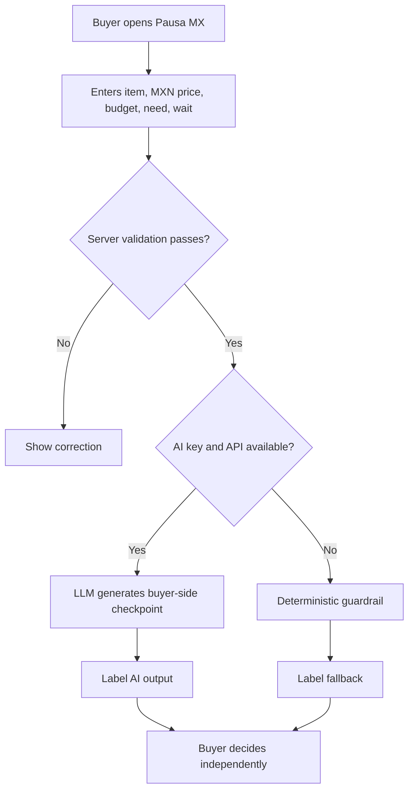
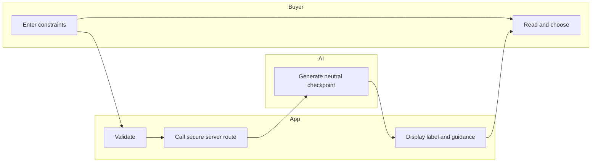

# WEEK 10 · BUSINESS BENDING · PACKET (draft before deployment)
## Problem
Mexican online shoppers face pressure from discounts and personalization that encourages buying before checking their own priorities. The buyer needs a private pause, not more product suggestions.
## Exact user
Valeria, 23, lives in Mexico City, shops on her phone, has a monthly discretionary spending limit and sometimes buys because of time-limited offers. Synthetic persona; not a real interview.
## Success definition
Before the module closes, a user can enter an item, price, discretionary budget, reason, and waiting tolerance; receive a buyer-first decision checkpoint in Spanish; see whether output was generated by AI or fallback rules; and complete the flow without creating an account.
## Screen mockup (wireframe — replace with image-generated mockup before submission)
```text
┌───────────────────────────────────────────┐
│ PAUSA MX · ¿Lo compro o espero?           │
│ Tu dinero, tus reglas.                    │
├───────────────────────────────────────────┤
│ ¿Qué quieres comprar? [Tenis             ]│
│ Precio MXN           [1,800              ]│
│ Presupuesto MXN      [1,200              ]│
│ ¿Para qué?           [Quiero estrenarlos ]│
│ ¿Puedes esperar?     [24 horas       ▾   ]│
│             [ AYÚDAME A DECIDIR ]         │
├───────────────────────────────────────────┤
│ Mejor espera · Precio > presupuesto       │
│ Tres preguntas + siguiente paso          │
│ Etiqueta: AI / reglas de respaldo         │
└───────────────────────────────────────────┘
```
## Mermaid flowchart

## Mermaid swimlane

## Global benchmark and Mexico translation
**Benchmark:** Consumer-facing spending controls such as Monzo's budgeting and spending insights show how timely friction can help people control money. **Localization:** Pausa MX accepts pesos and a self-declared discretionary budget, needs no bank account integration, and avoids recommending retailers. Unlike bank-specific tools, it works for cash and marketplace purchases. Benchmark claim requires independent verification before final submission.
## Three-year view
Pausa MX becomes a privacy-first personal purchase checkpoint across channels. Users may opt into encrypted purchase reflection histories and receipt scanning. The product stays buyer-funded or public-benefit supported, never financed by merchant commissions.
## Shadow and design decision
The chapter's shadow is optimization that quietly removes human autonomy. Therefore the app never auto-buys, never ranks stores, never uses affiliate links, and always lets the buyer make the final choice; outputs disclose when AI was used.
## Scope cut
No store, no merchant recommendation engine, no receipt OCR, no bank linking, no persistent personal profiles, no price scraping, no automation of purchases.
## Architecture and stack
| Layer | Technology | Responsibility |
|---|---|---|
| UI | Next.js / React | Spanish mobile-first form and result |
| User-constraint data | Submitted item, price, budget, reason, waiting window | Buyer-owned context for the single request |
| LLM | OpenAI API, server-side optional | Plain-language buyer-first checkpoint |
| Third component | Deterministic budget guardrails | Reliable non-AI fallback |
| Hosting | Vercel (pending) | Public deployment |
| Storage | None | Avoid sensitive retention and auth requirement |
## Security floor
No secrets in repo; server-side environment variable; server validation and length limits; no persistent personal data or database (RLS not applicable); synthetic test data only. Production rate limiting and monitoring are future work.
## Test plan
1. Price 1800, budget 1200: buyer sees over-budget warning.
2. Price 400, budget 1200: buyer sees a pause, not an automatic approval.
3. Missing item and negative price: form/server reject.
4. Overlong reason >400 chars: server rejects.
5. No API key: fallback is labeled clearly.
6. API configured: response is labeled AI; no store suggestions.
7. Mobile screen: all controls usable without horizontal scrolling.
8. Persona test: show sequential screenshots to a fresh synthetic-user chat, record actual confusions and fix worst one.
## Evidence status
Code prepared. Five verified Git commits, two Vercel deploys, mechanical bug-fix cycle, persona walkthrough, and demo video remain to be completed; do not represent them as finished.
